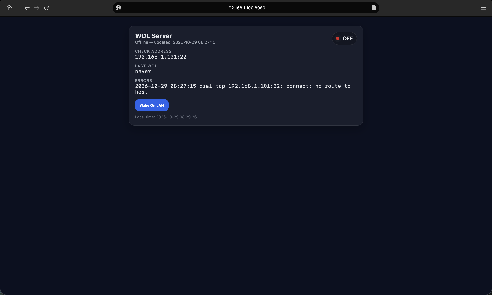
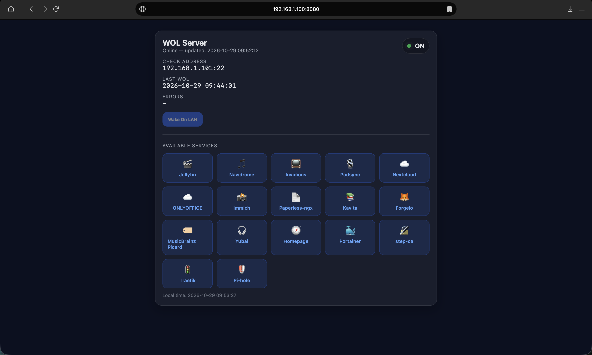

# wolweb - Minimal Wake-on-LAN Web Service

[](https://github.com/xabim/wolweb/actions/workflows/ci.yml)
[](https://github.com/xabim/wolweb/releases/latest)
[](https://opensource.org/licenses/MIT)

A lightweight, minimal web service for remotely waking up computers on your home network via Wake-on-LAN (WoL). Perfect for Raspberry Pi or similar single-board computers as a systemd service.

## Overview

`wolweb` provides a simple HTTP interface to:
- Send Wake-on-LAN packets to power on one or more home servers
- Monitor the online status of target devices
- Manage WoL requests with cooldown protection

## Screenshots

| Server off | Server on |
| --- | --- |
|  |  |

After a packet is sent, the button is disabled and a notice is shown until the configured `cooldown` has passed.

## Use Case

Deployed on a Raspberry Pi or similar device within your home network, `wolweb` allows you to:
1. Connect via VPN to your home network
2. Access the web interface
3. Wake up your home server or other devices
4. Access your server after it's online

## Features

- **Minimal Web UI** - Simple HTML interface for sending WoL packets
- **Status Monitoring** - Continuous checks for device online status
- **Cooldown Protection** - Prevents WoL packet spam; the UI shows a notice and disables the button meanwhile
- **Quick Links** - Show service links when server is online
- **Easy Deployment** - Single binary, runs as systemd service
- **Configurable** - TOML config file or command-line flags

## Installation

### From a release (recommended)

Download the archive for your platform from the [Releases page](https://github.com/xabim/wolweb/releases). For a Raspberry Pi use `linux_arm64` (64-bit OS), `linux_armv7` (32-bit Pi 2/3/4) or `linux_armv6` (Pi Zero/1).

```bash
tar xzf wolweb_<version>_linux_arm64.tar.gz
sudo install -m 0755 wolweb /usr/local/bin/
sudo install -d /etc/wolweb
sudo install -m 0644 wolweb.toml.example /etc/wolweb/config.toml   # then edit it
sudo install -m 0644 wolweb.service /etc/systemd/system/
sudo systemctl daemon-reload && sudo systemctl enable --now wolweb
```

Verify downloads against `checksums.txt` from the same release.

### Build from source

Requires Go (see `go.mod`) and a Linux system with systemd.

```bash
make build
```

This compiles `./wolweb`. Run `make install-bin` to also install it to `/usr/local/bin/wolweb`.

Or manually:

```bash
go build -o wolweb .
sudo install -m 0755 wolweb /usr/local/bin/
```

## Usage

### Command-line Flags

```bash
wolweb [flags]
```

- `-config` - Path to TOML config file (optional). Precedence: defaults < TOML file < explicitly set flags
- `-listen` - Address to listen on (default: `:8080`)
- `-checkAddr` - Address to check for online status, format `host:port` (required)
- `-checkTimeout` - Timeout for each connectivity check (default: `1s`)
- `-checkEvery` - Interval between status checks (default: `5m`)
- `-mac` - MAC address of the target device (required, format: `XX:XX:XX:XX:XX:XX`)
- `-broadcast` - Broadcast address for WoL packet (default: `255.255.255.255:9`)
- `-cooldown` - Cooldown between WoL requests (UI disables the button and shows a notice meanwhile) (default: `30s`)
- `-title` - Page title displayed in web UI (default: `Server Power`)

### Configuration File (TOML)

Pass the file with `-config`; a missing file is an error, as is running with neither `-config` nor any flags. Flags set on the command line override values from the file. The systemd unit uses `-config /etc/wolweb/config.toml`, and `make install-config` installs [wolweb.toml.example](wolweb.toml.example) there without overwriting an existing file.

```bash
wolweb -config /path/to/config.toml
```

Example configuration file:

```toml
[server]
mac = "AA:BB:CC:DD:EE:FF"
checkAddr = "192.168.1.100:22"
checkTimeout = "3s"
checkEvery = "30s"
broadcast = "255.255.255.255:9"
cooldown = "10s"
title = "Home Server WoL"
listen = ":8080"

# Links to display when server is online
[[links]]
name = "Nextcloud"
url = "https://nextcloud.home:8443"
icon = "☁️"

[[links]]
name = "Home Assistant"
url = "http://192.168.1.100:8123"
icon = "🏠"

[[links]]
name = "Jellyfin"
url = "http://192.168.1.100:8096"
icon = "🎬"
```

### Multiple servers

To manage several machines, replace `mac`/`checkAddr` and the top-level `[[links]]` with one `[[servers]]` entry per machine. Each card in the UI has its own status, cooldown and Wake button. `listen`, `title`, `checkTimeout`, `checkEvery`, `cooldown` and `broadcast` stay in `[server]` and apply to all servers (a server may override `broadcast`).

```toml
[server]
title = "Home"
cooldown = "30s"

[[servers]]
name = "NAS"                  # required (and unique) when more than one server
mac = "AA:BB:CC:DD:EE:01"
checkAddr = "192.168.1.100:22"

[[servers.links]]             # shown while this server is online
name = "Files"
url = "https://nas.home"
icon = "📁"

[[servers]]
name = "Media"
mac = "AA:BB:CC:DD:EE:02"
checkAddr = "192.168.1.101:22"
broadcast = "192.168.2.255:9" # optional per-server override
```

`[[servers]]` cannot be combined with `mac`/`checkAddr` (config or flags) or top-level `[[links]]`. The `-mac`/`-checkAddr` flags and the single-server layout above keep working unchanged. The wake endpoint is `POST /wake` with a `server` form field (the zero-based position in the file); it may be omitted when only one server is configured.

**Important:** When the server is **online**, the UI will show all configured links as clickable buttons with their icons. When offline, only the WoL button is available.

### Example

Using flags:
```bash
wolweb -mac "AA:BB:CC:DD:EE:FF" -checkAddr "192.168.1.100:22" -listen ":8080" -title "Home Server WoL"
```

Using config file:
```bash
wolweb -config wolweb.toml
```

## Systemd Service Setup

1. Install the config and service file:

```bash
make install
```

2. Edit your settings (the unit passes `-config /etc/wolweb/config.toml`; no need to touch the unit):

```bash
sudo $EDITOR /etc/wolweb/config.toml
```

3. Enable and start the service:

```bash
sudo systemctl daemon-reload
sudo systemctl enable wolweb
sudo systemctl start wolweb
```

4. Check status:

```bash
sudo systemctl status wolweb
```

## Example Systemd Unit

See [wolweb.service](wolweb.service) for a complete example configuration.

## Build and Installation with Makefile

```bash
make build          # Compile ./wolweb
make test           # Run tests with the race detector
make install-bin    # Install the binary to /usr/local/bin
make clean          # Remove built binaries
make install-config # Install example config to /etc/wolweb (never overwrites)
make install        # Install config and systemd service file
make uninstall      # Remove systemd service file
```

## CI/CD

This project uses GitHub Actions for continuous integration:

- **Linting** - golangci-lint checks code quality
- **Testing** - Runs all tests with coverage reporting
- **Multi-platform builds** - Automatically builds for:
  - Linux (amd64, arm, arm64) - Perfect for Raspberry Pi!
  - macOS (amd64, arm64)
  - Windows (amd64)
- **Automated Releases** - Tags trigger automatic binary releases

### Building Different Architectures Locally

```bash
# Linux ARM (Raspberry Pi)
GOOS=linux GOARCH=arm GOARM=7 go build -o wolweb-rpi .

# Linux ARM64
GOOS=linux GOARCH=arm64 go build -o wolweb-arm64 .

# Linux x86-64
GOOS=linux GOARCH=amd64 go build -o wolweb-amd64 .
```

## Security Considerations

- **VPN Access Only** - Run behind a VPN or private network only
- **Firewall Rules** - Restrict HTTP access to trusted sources
- **No Authentication** - This service has no built-in authentication; rely on network security
- **CSRF** - `POST /wake` rejects cross-site browser requests (`Sec-Fetch-Site`), but this is not a substitute for network access control
- **Trusted config** - Link URLs from the config file are rendered as-is (any scheme except `javascript:`, `data:`, `vbscript:`); keep the config file writable only by trusted users
- **Unknown config keys** - Typos in the TOML file are rejected at startup
- **HTTPS** - Consider using a reverse proxy (nginx) with SSL/TLS for production

## Releasing

Releases are built by [GoReleaser](https://goreleaser.com) via GitHub Actions. The workflow runs the tests, builds binaries for Linux (amd64, arm64, armv7, armv6), macOS and Windows, and publishes a GitHub Release with checksums and a changelog generated from conventional commits.

To release, go to **Actions → Release → Run workflow** on `main` and enter the version (e.g. `v1.1.0`); the workflow creates the tag for you. Only people with write access to the repository can run it. Pushing a `v*.*.*` tag by hand also works.

To try a build locally without publishing: `goreleaser release --snapshot --clean`.

## Contributing

Contributions are welcome, see [CONTRIBUTING.md](CONTRIBUTING.md).

## License

Released under the [MIT License](LICENSE). Copyright (c) 2026 Javier Marti.
